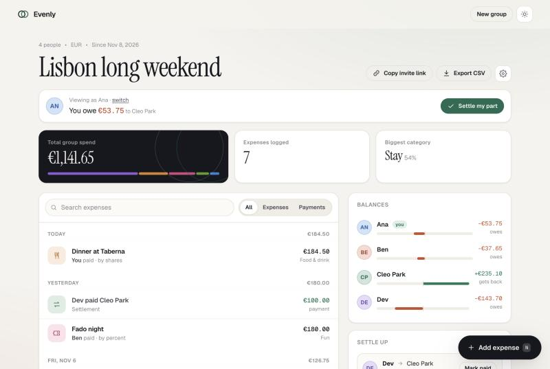

# Evenly

**Split shared costs with anyone. No accounts, no app install, no daily limits.**

[](https://github.com/Sun-sh902/evenly/actions/workflows/ci.yml)
[](LICENSE)




## Why

In late 2023 Splitwise capped its free tier at a handful of expenses per day, and people still go looking for alternatives because of it. The ask is always the same:

- let me add as many expenses as I want
- don't make my friends create accounts
- handle uneven splits properly
- tell us the fewest payments needed to settle

Evenly does exactly that, and you can host it yourself with a single command.

## Features

- **Groups in ten seconds.** Name, currency, people. Share the link and everyone can view and add expenses.
- **Four split modes:** equally, exact amounts, shares (2:1:1) and percent. Money is stored as integer cents and allocated by largest remainder, so splits always add up to the total exactly.
- **Your own view.** Pick which person you are and Evenly shows what *you* owe or get back, with a one-tap "Settle my part". Saved per device; no login.
- **Live sync.** Open tabs pick up changes from other people within seconds. Polling uses ETags, so an idle tab costs a 304.
- **Settle up** with at most n-1 suggested payments, each recorded in one tap.
- **Search, filters and a day-grouped activity feed**; edit or delete anything and balances recalculate right away.
- **Group settings:** rename, change currency, delete the group.
- **CSV export**, with spreadsheet-formula injection neutralised.
- **15 currencies**, including zero-decimal ones (JPY, KRW).
- Light and dark themes, a mobile bottom sheet, keyboard shortcuts (`N` adds an expense, `/` jumps to search).

## Quick start

Requires Node.js 22.13 or newer. Nothing to install: the server uses the built-in `node:sqlite`.

```bash
git clone https://github.com/Sun-sh902/evenly.git
cd evenly
npm start                     # http://127.0.0.1:4173
```

```bash
npm test                      # unit and end-to-end acceptance tests
node scripts/seed-demo.js     # create a demo group (server must be running)
```

### Docker

```bash
docker build -t evenly .
docker run -d -p 4173:4173 -v evenly-data:/data --name evenly evenly
```

## Configuration

| Variable                   | Default          | Purpose                                              |
|----------------------------|------------------|------------------------------------------------------|
| `PORT`                     | `4173`           | HTTP port                                            |
| `HOST`                     | `127.0.0.1`      | Bind address (`0.0.0.0` in Docker)                   |
| `EVENLY_DB`                | `data/evenly.db` | SQLite database file                                 |
| `EVENLY_WRITES_PER_MINUTE` | `120`            | Write requests per client IP per minute              |
| `EVENLY_GROUPS_PER_HOUR`   | `30`             | New groups per client IP per hour                    |
| `EVENLY_RATE_LIMIT`        | unset            | Set to `off` to disable rate limiting                |
| `TRUST_PROXY`              | unset            | Set to `1` behind a reverse proxy to use `X-Forwarded-For` |
| `QUIET`                    | unset            | Disable request logging                              |

Rate limits only guard against abuse; there is no cap on how many expenses a group can hold.

## API

Amounts in requests are decimal strings or numbers (`"12.50"`). Responses carry integer minor units plus a `digits` field.

| Method | Path | Notes |
|--------|------|-------|
| GET    | `/api/health` | |
| GET    | `/api/meta` | currencies and categories |
| POST   | `/api/groups` | `{ name, currency, members: [names] }` |
| GET    | `/api/groups/:id` | snapshot with members, entries, balances, transfers, stats and `revision`. Sends a weak `ETag`; send `If-None-Match` to get `304` when nothing changed |
| PATCH  | `/api/groups/:id` | `{ name?, currency? }` |
| DELETE | `/api/groups/:id` | |
| POST   | `/api/groups/:id/members` | `{ name }` |
| PATCH  | `/api/groups/:id/members/:memberId` | `{ name }` |
| DELETE | `/api/groups/:id/members/:memberId` | only for people not on any expense |
| POST   | `/api/groups/:id/entries` | expense: `{ title, amount, paidBy, category?, date?, note?, split: { mode, participants: [{ memberId, value? }] } }`<br>payment: `{ kind: "transfer", amount, paidBy, to, date? }` |
| PUT    | `/api/groups/:id/entries/:entryId` | same body as POST |
| DELETE | `/api/groups/:id/entries/:entryId` | |
| GET    | `/api/groups/:id/export.csv` | |

Errors come back as `{ "error": "message", "field": "amount" }` with status 400, 404, 405, 409, 413, 415 or 429 (with `Retry-After`).

## Project layout

```
src/
  money.js     currency table, decimal parsing, exact allocation
  ledger.js    split resolution, balances, settle-up algorithm
  store.js     SQLite persistence, validation, schema migration
  app.js       HTTP router, ETags, rate limiting, static files, security headers
  server.js    entry point
public/        single page frontend (vanilla JS, no build step)
test/          node:test unit and acceptance suites
scripts/       demo data seeder
```

## Security model

A group's link is its key, the same model as Splid or Spliit. Group IDs are 12 random characters from a 55-symbol alphabet (about 69 bits). Request bodies are capped at 64 KB, writes are rate limited per IP, static file serving rejects path traversal, and every response carries a strict CSP (no inline scripts), `nosniff` and `frame-ancestors 'none'`. Put Evenly behind HTTPS if you expose it to the internet.

## Contributing

See [CONTRIBUTING.md](CONTRIBUTING.md).

## License

[MIT](LICENSE)
